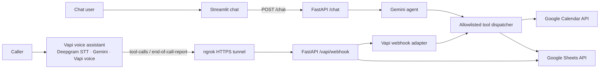

# Cedar Lane Auto Detailing AI Receptionist

A two-phase AI receptionist built for the ProcIndex take-home assignment. Phase 1 provides a Streamlit text chat. Phase 2 connects a Vapi voice assistant to the same Python backend for appointment and customer operations.

## Features

- Answers configured questions about services, hours, pricing, preparation, vehicle eligibility, and policies.
- Checks Google Calendar availability before offering appointment times.
- Books, finds, reschedules, and cancels appointments through backend tools.
- Prompts the caller to confirm appointment details before booking or changing an appointment; the backend rechecks availability before Calendar writes.
- Logs caller interactions and maintains customer records in Google Sheets.
- Records human follow-up requests. There is no live staff-notification integration.
- Uses Gemini with explicit function calling in the text receptionist. The Vapi assistant uses the model, transcriber, and voice selected in Vapi.

## Architecture



The model can request a tool, but Python validates and executes the supported operation. Google Calendar is the source of appointment availability and events. Google Sheets stores contact and interaction records.

## Technology

- Python 3.12+
- FastAPI and Uvicorn
- Streamlit
- Google Gemini through Google's Gen AI SDK
- Vapi for voice calls
- Deepgram Nova 3 speech transcription (configured in Vapi)
- Google Calendar API and Google Sheets API
- Pydantic, PyYAML, pytest, and `uv`

## Prerequisites

- Windows PowerShell (commands below), Python 3.12+, and [`uv`](https://docs.astral.sh/uv/).
- A Gemini API key for the Phase 1 chat backend.
- A Google Cloud service account with the Calendar and Sheets APIs enabled.
- A Google Calendar and Google Spreadsheet shared with the service account email.
- For Phase 2: a Vapi account, a Gemini provider key configured in Vapi, and ngrok or another public HTTPS endpoint for local webhook testing.

## Configuration

Create `.env` from the example if you do not already have one:

```powershell
Copy-Item .env.example .env
```

Edit `.env` and set the values for your own accounts:

```dotenv
GOOGLE_APPLICATION_CREDENTIALS=credentials/service-account.json
CALENDAR_ID=your-calendar-id
SHEET_ID=your-spreadsheet-id
SHOP_TZ=Asia/Kolkata

GEMINI_API_KEY=your-gemini-api-key
GEMINI_MODEL=gemini-3.8-flash

VAPI_SERVER_URL=https://your-public-host/vapi/webhook
VAPI_WEBHOOK_TOKEN=replace-with-a-long-random-token
VAPI_CREDENTIAL_ID=your-vapi-bearer-credential-id
```

`VAPI_WEBHOOK_TOKEN` must match the token in the Vapi Bearer credential. Use the `Authorization` header with the Bearer prefix enabled. `VAPI_CREDENTIAL_ID` is used by the assistant JSON export script; it is optional when you configure the assistant entirely in the Vapi dashboard and select the credential there.

Keep `.env` and the service-account JSON private. Do not commit credentials or real customer information. The `.gitignore` excludes these local files.

### Google setup

1. Enable the Google Calendar API and Google Sheets API in your Google Cloud project.
2. Create or use a service account and download its JSON key to `credentials/service-account.json` (or set `GOOGLE_APPLICATION_CREDENTIALS` to its location).
3. Share the target Calendar and spreadsheet with the service account email. Grant permission to create and update Calendar events and edit the spreadsheet.
4. Set `CALENDAR_ID` and `SHEET_ID` in `.env`.
5. Prepare the Contacts and Call Log tabs and headers:

   ```powershell
   uv run python scripts/setup_sheets.py
   ```

The setup script creates missing tabs and writes the expected header rows. Run it against the intended spreadsheet.

## Run Phase 1: text chat

Install dependencies:

```powershell
uv sync
```

Start the backend in one PowerShell terminal:

```powershell
uv run uvicorn main:app --reload --host 127.0.0.1 --port 8000
```

Check the health endpoint at `http://127.0.0.1:8000/health`. FastAPI's interactive API docs are at `http://127.0.0.1:8000/docs`.

Start Streamlit in a second terminal:

```powershell
uv run streamlit run phase-1-chat/app.py
```

Open the local URL printed by Streamlit (usually `http://localhost:8501`). The UI maintains a session ID while the chat is open and sends messages to the backend. Starting a new conversation finalizes the prior session for Sheets logging.

## Run Phase 2: Vapi voice

### Start FastAPI and ngrok

Vapi must be able to reach the backend over HTTPS. Run FastAPI in one terminal:

```powershell
uv run uvicorn main:app --host 0.0.0.0 --port 8000
```

Run ngrok in another terminal:

```powershell
ngrok http 8000
```

Copy the active HTTPS forwarding URL and append `/vapi/webhook`, for example:
`https://example.ngrok-free.dev/vapi/webhook`. Update the assistant's Webhook Server URL in Vapi whenever the tunnel URL changes. Keep both processes running during calls.

### Configure the Vapi assistant

1. Add your Gemini API key to Vapi under Integrations. The local `GEMINI_API_KEY` is not automatically shared with Vapi.
2. Create and publish Function tools using the schemas in `vapi_assistant.json` (or generate a fresh reference with the command below). Attach the tools to the assistant.
3. In the assistant's **Advanced → Webhook Server** settings, set the HTTPS `/vapi/webhook` URL and select a Bearer credential whose token matches `VAPI_WEBHOOK_TOKEN`.
4. Ensure the assistant sends `tool-calls` and `end-of-call-report` server messages.
5. Publish the assistant version. Use **Talk** for a browser voice test, or assign an inbound phone number to the assistant.

Generate the current assistant configuration reference from project settings:

```powershell
uv run python scripts/export_vapi_assistant.py --output vapi_assistant.json
```

This file contains the prompt, model selection, tool schemas, and Vapi server settings. The dashboard and Vapi account still need to be configured; generating the JSON does not create or publish an assistant automatically.

## Tests

Run automated tests with:

```powershell
uv run pytest
```

Tests use mocks/fakes for external services and should not create real Calendar events. Real Google and Vapi behavior must be verified separately with controlled test accounts and appointments.

## Repository layout

```text
agent.py                 Gemini chat agent and tool-call loop
main.py                  FastAPI routes: health, chat, Vapi webhook
vapi_integration.py      Vapi webhook adapter for tool calls and call reports
tools/                   Allowlisted business tools and schemas
gcal.py                  Google Calendar API integration
sheets.py                Google Sheets contacts and call-log integration
session.py               In-process conversation and call state
shop.yaml                Configured business facts and service settings
phase-1-chat/app.py       Streamlit text chat
scripts/                 Google Sheets setup and Vapi config export
tests/                   Unit and mocked integration tests
```

## Limitations

- Active conversation and idempotency state is held in process memory. Restarting the backend clears active sessions; this is a take-home implementation, not a multi-instance production deployment.
- Appointment confirmation is currently enforced through the assistant conversation and tool instructions, not a separate server-side confirmation token. Do not treat this as production-grade authorization for booking, rescheduling, or cancellation.
- An ngrok free URL may change when its tunnel restarts. Update Vapi's webhook URL when it does.
- Human escalation is recorded for staff follow-up but does not notify or transfer to a real employee.
- Vapi phone-number availability and calling capabilities depend on the selected number/provider and account. A browser **Talk** call can be used for development testing.
- Do not use production customer data or an uncontrolled live calendar for demonstrations.
